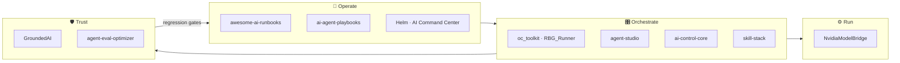

<!-- ░░ HEADER ░░ -->
<p align="center">
  
</p>

<p align="center">
  <a href="https://brathod1432.github.io">
    
  </a>
</p>

<p align="center">
  <a href="https://brathod1432.github.io"></a>
  <a href="https://www.linkedin.com/in/rbrijesh07/"></a>
  <a href="mailto:bgrathod00@gmail.com"></a>
  
</p>

<p align="center">
  
</p>

## ⚡ In short

I'm a Warsaw-based engineer working where **AI agents, quality engineering, and production software** meet. I came into software from Mechatronics & Robotics (M.Sc., Warsaw University of Technology) through test automation, and today I lead automation and quality engineering for enterprise storage at **Dell Technologies**. Alongside that I've helped **10+ businesses** improve their applications and put AI to work in them.

My open-source work follows one idea: **AI should be operable, not just impressive** — every agent gets a runbook, every model gets an eval, every product gets tests, guardrails, and a human in the loop.

```yaml
engineer:
  based_in:   Warsaw, Poland 🇵🇱
  day_job:    Automation Team Lead · Dell Technologies (PowerStore)
  building:   [agent runbooks, multi-agent orchestration, AI ops platforms]
  believes:   "AI recommends, humans decide."
  ships_with: [tests, evals, audit trails, docs]
```

## 🚀 Latest builds

<table>
  <tr>
    <td width="50%" valign="top">
      <h3>📚 <a href="https://github.com/brathod1432/ai-runbooks">awesome-ai-runbooks</a></h3>
      Open-source library of <b>operational runbooks for autonomous AI agents</b> — SRE-playbook discipline applied to Claude Code, Devin, Cursor, AutoGen, LangGraph and MCP agents.<br/><br/>
      
      
      
    </td>
    <td width="50%" valign="top">
      <h3>🧭 <a href="https://github.com/brathod1432/ai-command-center">Helm · AI Command Center</a></h3>
      An <b>AI business-operations platform</b> unifying email, Jira, GitHub, CRM and support into one governed view. Ten specialist agents produce cited, confidence-scored insights; every action passes a human approval gate and audit trail.<br/><br/>
      
      
      
    </td>
  </tr>
  <tr>
    <td width="50%" valign="top">
      <h3>🎛️ <a href="https://github.com/brathod1432/oc_toolkit">oc_toolkit · RBG_Runner</a></h3>
      Copy-and-go <b>multi-agent toolkit for Open Code</b>: 12 agents and reusable skills, orchestrated by <b>RBG_Runner</b>, which discovers agents, builds a dependency graph and triggers them on schedules or conditions.<br/><br/>
      
      
    </td>
    <td width="50%" valign="top">
      <h3>🖥️ ApexAssist <sub><i>(private)</i></sub></h3>
      A desktop <b>on-screen task assistant</b>. One hotkey captures what's on screen, local OCR reads it, and an AI model streams step-by-step help into a lightweight overlay; voice notes are transcribed and answered the same way.<br/><br/>
      
      
    </td>
  </tr>
  <tr>
    <td width="50%" valign="top">
      <h3>🧩 <a href="https://github.com/brathod1432/RBG_Candidate">RBG Candidate</a></h3>
      Privacy-first <b>Chrome/Edge MV3 extension</b> that fills job applications with AI — a coordinator splits each form across 15 parallel workers, data stays AES-GCM encrypted on-device, and nothing is filled without review.<br/><br/>
      
      
    </td>
    <td width="50%" valign="top">
      <h3>🎯 <a href="https://github.com/brathod1432/Sporty_Test">Sporty_Test</a></h3>
      End-to-end <b>QA harness for a betting flow</b>: risk-based test strategy, 42 automated API + UI checks with pytest, requests and Selenium, and 22 documented defects with evidence.<br/><br/>
      
      
    </td>
  </tr>
</table>

## 🗺️ How the work fits together



## 🧰 Explore by area

<details open>
<summary><b>🤖 AI Agents & Operations</b></summary>
<br/>

| Repo | What it does |
|---|---|
| [**awesome-ai-runbooks**](https://github.com/brathod1432/ai-runbooks) | Vendor-neutral operational runbooks for autonomous agents — 48 runbooks, quality-scored, 1,000+ tests |
| [**ai-agent-playbooks**](https://github.com/brathod1432/ai-agent-playbooks) | Evidence-first, verification-mandatory playbooks for coding agents (Claude Code, Devin, Cursor, Codex, Gemini CLI) |
| [**ai-command-center**](https://github.com/brathod1432/ai-command-center) | Helm — governed multi-agent business-ops platform with human approval gates |
| [**oc_toolkit**](https://github.com/brathod1432/oc_toolkit) | Drop-in agents + skills for Open Code with the RBG_Runner orchestrator |
| [**agent-studio**](https://github.com/brathod1432/agent-studio) | Local-first, provider-agnostic agent workspace — zero runtime deps, keys stored by reference |
| [**ai-control-core**](https://github.com/brathod1432/ai-control-core) | Model-agnostic library of reusable AI-ops assets — skills, rules, templates (1,050+ indexed) |
| [**skill-stack**](https://github.com/brathod1432/skill-stack) | Agent-agnostic library of developer & automation-engineering skills |
| [**linkedin_automation**](https://github.com/brathod1432/linkedin_automation) | Personal LinkedIn assistant — feed digests, job search & fit scoring, review-only by default |

</details>

<details>
<summary><b>🛡️ LLM Evaluation, Safety & Infrastructure</b></summary>
<br/>

| Repo | What it does |
|---|---|
| [**GroundedAI**](https://github.com/brathod1432/GroundedAI) | Grounded LLM verification — hallucination scoring, claim/evidence API, PII & prompt-injection shielding |
| [**agent-eval-optimizer**](https://github.com/brathod1432/agent-eval-optimizer) | Evaluation-driven optimisation for agents — trajectory scoring, regression gates, CI-ready reports |
| [**NvidiaModelBridge**](https://github.com/brathod1432/NvidiaModelBridge) | Production FastAPI gateway for NVIDIA models — routing, caching, circuit breakers, observability |

</details>

<details>
<summary><b>🧪 Quality Engineering</b></summary>
<br/>

| Repo | What it does |
|---|---|
| [**Sporty_Test**](https://github.com/brathod1432/Sporty_Test) | Risk-based test strategy + 42 API/UI checks + defect vault for a single-bet placement flow |
| [**RBG_Candidate**](https://github.com/brathod1432/RBG_Candidate) | MV3 extension + FastAPI proxy with layered tests and privacy-by-design storage |

</details>

<details>
<summary><b>🦾 Robotics</b></summary>
<br/>

| Repo | What it does |
|---|---|
| [**roboarm-ai-toolkit**](https://github.com/brathod1432/roboarm-ai-toolkit) | Robot-arm kinematics — 5 IK solvers, Jacobian analysis, trajectory planning, natural-language agents |
| [**parametric-robot-design-automation**](https://github.com/brathod1432/parametric-robot-design-automation) | CAD-agnostic parametric design — URDF / OpenSCAD / BOM / DXF export (396 tests) |

</details>

<details>
<summary><b>🌐 Full-Stack & SaaS Starters</b></summary>
<br/>

| Repo | What it does |
|---|---|
| [**saas-dashboard-demo**](https://github.com/brathod1432/saas-dashboard-demo) | Enterprise SaaS dashboard — 3-layer RBAC, charts, data tables, command palette |
| [**client-portal-starter**](https://github.com/brathod1432/client-portal-starter) | Secure client portal — 12 modules, RBAC, audit trail |
| [**business-website-starter**](https://github.com/brathod1432/business-website-starter) | Re-brandable marketing site — strong SEO, JSON-LD, accessibility |

</details>

<details>
<summary><b>🧠 ML Foundations</b></summary>
<br/>

| Repo | What it does |
|---|---|
| [**mlp-study-kit**](https://github.com/brathod1432/mlp-study-kit) | Multi-Layer Perceptron from scratch in NumPy — single neuron → TensorFlow/Keras |

</details>

## 🔭 Right now

- 🧭 Growing **awesome-ai-runbooks** into the reference for running agents in production
- 🎛️ Making **RBG_Runner** smarter about scheduling, dependencies and self-triggering agents
- 🖥️ Sharpening **ApexAssist**'s screen-understanding prompts and per-language output contracts
- 🎓 M.Sc. research on **interpreting commands for assistive robots with vision-language models**

## 🛠️ Toolbox

<p align="center">
  <br/>
  
</p>

<p align="center">
  
  
  
  
  
  
</p>

## 📊 Activity

<p align="center">
  
  
</p>

<p align="center">
  
</p>

<p align="center">
  <i>Open to collaboration on AI agents, quality engineering and robotics — the fastest way to reach me is through the <a href="https://brathod1432.github.io">portfolio</a> or <a href="https://www.linkedin.com/in/rbrijesh07/">LinkedIn</a>.</i>
</p>

<p align="center">
  
</p>
