

  

  

  &nbsp;
  &nbsp;
  

 

  

 

  Warsaw-based engineer working where <b>AI agents</b>, <b>quality engineering</b> and <b>production software</b> meet. 
  Senior Full-Stack Engineer at <b>Capgemini</b>, developing and integrating AI solutions on the <b>Neo</b> project. 
  Freelance <b>senior AI software consultant</b> — I design system architectures and ship new AI features & workflows for companies. 
  Mechatronics & Robotics M.Sc. → test automation (previously leading automation at Dell) → full-stack AI engineering.  
  <i>AI should be operable, not just impressive — every agent gets a runbook, every model an eval, every product a human in the loop.</i>

  
  
  
  

## ✨ Featured work

  <a href="https://github.com/brathod1432/ai-runbooks" title="Open awesome-ai-runbooks on GitHub"></a>
  <a href="https://github.com/brathod1432/ai-agent-playbooks" title="Open ai-agent-playbooks on GitHub"></a> 
  <a href="https://github.com/brathod1432/skill-stack" title="Open skill-stack on GitHub"></a>
  <a href="https://github.com/brathod1432/ai-control-core" title="Open ai-control-core on GitHub"></a> 
  <a href="https://github.com/brathod1432/ai-command-center" title="Open Helm (ai-command-center) on GitHub"></a>
  <a href="https://github.com/brathod1432/oc_toolkit" title="Open oc_toolkit on GitHub"></a> 
  <a href="https://github.com/brathod1432/agent-studio" title="Open agent-studio on GitHub"></a>
  <a href="https://brathod1432.github.io" title="ApexAssist is private - see my portfolio"></a> 
  <a href="https://github.com/brathod1432/GroundedAI" title="Open GroundedAI on GitHub"></a>
  <a href="https://github.com/brathod1432/agent-eval-optimizer" title="Open agent-eval-optimizer on GitHub"></a> 
  <a href="https://github.com/brathod1432/NvidiaModelBridge" title="Open NvidiaModelBridge on GitHub"></a>
  <a href="https://github.com/brathod1432/RBG_Candidate" title="Open RBG Candidate on GitHub"></a> 

## 🧰 All projects

&nbsp;<b>AI agents & operations</b>

 

| Project | What it does |
|:--|:--|
| [ai-agent-playbooks](https://github.com/brathod1432/ai-agent-playbooks) | Verifiable, evidence-first playbooks for coding agents |
| [agent-studio](https://github.com/brathod1432/agent-studio) | Local-first, provider-agnostic agent workspace |
| [ai-control-core](https://github.com/brathod1432/ai-control-core) | Reusable AI-ops skills, rules and templates |
| [skill-stack](https://github.com/brathod1432/skill-stack) | Agent-agnostic engineering skills library |
| [linkedin_automation](https://github.com/brathod1432/linkedin_automation) | Personal LinkedIn assistant, review-only by default |

&nbsp;<b>LLM evaluation & infrastructure</b>

 

| Project | What it does |
|:--|:--|
| [agent-eval-optimizer](https://github.com/brathod1432/agent-eval-optimizer) | Trajectory scoring and regression gates for agents |
| [NvidiaModelBridge](https://github.com/brathod1432/NvidiaModelBridge) | Production gateway for NVIDIA models — routing, caching, observability |

&nbsp;<b>Robotics & ML</b>

 

| Project | What it does |
|:--|:--|
| [roboarm-ai-toolkit](https://github.com/brathod1432/roboarm-ai-toolkit) | Robot-arm kinematics, IK solvers and trajectory planning |
| [parametric-robot-design-automation](https://github.com/brathod1432/parametric-robot-design-automation) | Parametric robot design with URDF / CAD / BOM export |
| [mlp-study-kit](https://github.com/brathod1432/mlp-study-kit) | Multi-layer perceptron from scratch in NumPy |

&nbsp;<b>Full-stack starters</b>

 

| Project | What it does |
|:--|:--|
| [saas-dashboard-demo](https://github.com/brathod1432/saas-dashboard-demo) | Enterprise SaaS dashboard with 3-layer RBAC |
| [client-portal-starter](https://github.com/brathod1432/client-portal-starter) | Secure client portal with audit trail |
| [business-website-starter](https://github.com/brathod1432/business-website-starter) | SEO- and accessibility-first marketing site |

## 🔭 Now

- Growing **awesome-ai-runbooks** into a reference for running agents in production
- Smarter scheduling and dependencies for **RBG_Runner**
- Sharper screen understanding in **ApexAssist**
- M.Sc. research on **vision-language models for assistive robots**

## 🛠️ Toolbox

  

  &nbsp;
  &nbsp;
  

  
  
  
  
  

 

  Open to collaboration on AI agents, quality engineering and robotics · <a href="https://brathod1432.github.io">brathod1432.github.io</a>

  

